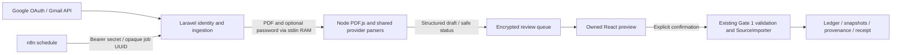

# Automatic Mode — Implementation Report

Tanggal: 29 Oktober 2026. **MVP internal diimplementasikan dan diuji sintetis; demonstrasi Gmail → n8n nyata BLOCKED.** Google OAuth client dan n8n belum dikonfigurasi oleh pemilik. Tidak ada email yang diambil/dikirim secara live. Scope dibatasi ingestion dengan mandatory review; parser email body belum dibuat tanpa sampel.

## 1. Arsitektur dan batas privasi

Laravel memegang identitas dan tokens. n8n tidak menerima email address, raw email body, PDF, password PDF, financial payload, OAuth access/refresh tokens atau receipt detail. Internal endpoints hanya job UUID dan ringkasan status/count/UNKNOWN coverage. PDF dan teks hasil ekstraksi Automatic ada sementara pada memory backend/subprocess; structured draft/locator tersimpan terenkripsi. Tidak menyimpan PDF asli atau password secara permanen.

Privacy Mode tetap browser-only untuk PDF/password; backend hanya menerima allowlisted structured data setelah konfirmasi. Automatic Mode merupakan trust boundary berbeda: bytes/password attachment dapat diproses pada server lokal. Tidak menggunakan istilah Zero-Knowledge. UI sidebar/settings membedakan kedua boundary agar tidak memberikan janji browser-only untuk seluruh aplikasi.

## 2. OAuth dan multiple Gmail

Web server authorization-code flow memakai state acak, context terikat user/session dengan expiry 10 menit dan single-use pull, PKCE S256, redirect/backend/frontend yang dibatasi loopback HTTP untuk MVP lokal. State/verifier context dienkripsi sebelum disimpan di session database. Redirect callback tidak mengirim code/token ke React; hanya fixed status.

Scope tunggal gmail.readonly digunakan untuk membaca message/attachment, tanpa send/modify/delete. Scope ini termasuk restricted; rilis publik dapat membutuhkan verification dan security assessment sesuai cara data disimpan/diproses. [Google Gmail scope documentation](https://developers.google.com/workspace/gmail/api/auth/scopes).

EmailConnection.credentials menggunakan encrypted cast existing, hidden dari serialization; berisi access token, refresh token dan expiry. Email Gmail adalah identitas koneksi yang disimpan dengan consent, berbeda dari nomor rekening/RDN/SID pada laporan investasi yang tidak diminta. Multiple koneksi per user diuji; satu akun investasi memilih satu koneksi, satu Gmail dapat dipakai beberapa akun. Pemilihan akun tetap ditinjau manusia, terutama jika ada beberapa akun provider yang sama.

Refresh terkunci per connection; invalid_grant/revoked token menghasilkan RECONNECT_REQUIRED. Disconnect terlebih dahulu menjeda semua akun terkait dan menghapus credentials lokal; revocation ke Google dicoba kemudian. Bila tidak terkonfirmasi, UI meminta pemilik mencabut izin melalui Google. Pause/disconnect tetap dapat dilakukan meskipun automatic.enabled dinonaktifkan. Disconnect satu koneksi dapat berdampak pada grant Google yang sama bila Google account/client dipakai di tempat lain; perilaku live perlu diuji.

Google menganjurkan library OAuth yang telah teruji. MVP ini memakai Laravel HTTP yang sudah ada tanpa dependency baru; audit keamanan tambahan dan pengujian Google live wajib sebelum pemakaian publik. [Google web-server OAuth guidance](https://developers.google.com/identity/protocols/oauth2/web-server).

## 3. Akuisisi dan source matrix

Sinkronisasi mencari label Gmail yang ditentukan pemilik, default TAP_FLX_IMPORT, dalam jendela 90 hari. Lima message per page dan maksimum lima attachment baru per invocation; page token dienkripsi. Jika batas attachment tercapai, page saat ini diulang, item lama dilewati melalui identity hash, sehingga sisa page tidak langsung ditinggalkan. MORE_AVAILABLE berarti perlu invocation berikutnya. Setelah page terakhir, scan dimulai lagi. Tidak memakai Gmail history cursor/push notifications dan tidak mengklaim coverage lengkap.

Exact sender email allowlist wajib dikonfigurasi per provider; kosong menghasilkan SOURCE_FILTER_REQUIRED. Display name tidak dipercaya. Filter sender dan provider text **bukan bukti autentisitas**; preview selalu sender_assurance UNVERIFIED dan mandatory review. Tidak memvalidasi DKIM/SPF secara independen. PDF diambil hanya dari MIME application/pdf dengan attachmentId, struktur MIME dibatasi. Field API menghindari body.data, snippet dan filename; headers hanya berada di memory dan From dipakai untuk filter.

- BIONS PDF: SOA, TC, CA cash dividend memakai parser existing.
- Stockbit PDF: SOA, TC memakai parser existing. Dividend email belum ada sampel terverifikasi: UNSUPPORTED_EMAIL bila message tanpa PDF yang didukung.
- Pluang PDF: Monthly Statement memakai parser existing. Transaction email belum ada sampel: UNSUPPORTED_EMAIL.
- Inline PDF tanpa attachmentId, nested MIME melewati batas, image scan/OCR, attachment format lain dan variasi tidak teruji belum didukung. Tidak menganggap seluruh peristiwa investasi berasal dari PDF.

Raw text belum pernah dikirim ke cloud LLM; tidak ada AI parser fallback atau news integration.

## 4. Review, password dan import

Worker stdin JSON membawa PDF base64, hash bytes, account/provider, batch key dan optional password. Parser limit 20 MiB/100 halaman; Process timeout 60 detik, heap Node 256 MiB, eval/XFA dinonaktifkan. Output hanya draft terstruktur atau fixed status; stderr tidak dipersist/ditampilkan. Kesalahan runtime menjadi PARSER_UNAVAILABLE. Process environment hanya membawa kebutuhan OS, tanpa backend secrets. Batas ini bukan sandbox OS; PDF untrusted tetap risiko parser/native runtime.

PASSWORD_REQUIRED/WRONG_PASSWORD/DECRYPTION_FAILED ditahan dalam queue. Owner mengirim password type=password langsung ke authenticated endpoint lokal; Laravel mengambil ulang attachment dan memberikan password lewat stdin. Tidak melewati n8n, URL, command arguments, database, log atau analytics. Password React dikosongkan setelah request/close. Privacy Mode tidak berubah menjadi upload-password flow.

READY_FOR_REVIEW berarti preview parser tersedia, **bukan** final financial acceptance. Draft disimpan confirmed=false. POST confirm menerima hanya accepted confirmed dan tidak menerima financial overrides dari browser. Confirm memanggil SourceImportController/SourceImporter existing di dalam transaksi: allowlist, ownership/provider, decimal precision, arithmetic, row identity, source conflict, candidate duplicate, audit dan snapshot rules berlaku kembali. Hard backend failure mengembalikan 422 dan tidak menulis canonical data. Draft dihapus setelah import; receipt tersimpan, source observations tetap menjadi evidence.

Tidak ada auto-accept confidence atau unit conversion. Quantity UNKNOWN, snapshot coverage UNKNOWN dan source ambiguity tetap memerlukan review sesuai Gate 1–3. UI penyelesaian unit/financial correction lanjutan tidak ditambah pada gate ini; perbaiki melalui workflow existing yang sesuai dan jangan memaksa angka untuk melewati validation.

## 5. Mode switch dan idempotency

Acquisition mode per account default PRIVACY. AUTOMATIC membutuhkan owned active Gmail connection dan explicit consent. PRIVACY menjeda ingestion; disconnect kembali ke PRIVACY. Ledger/snapshots/source history tidak dihapus.

Setiap perubahan policy menaikkan acquisition_epoch dan mengosongkan cursor/lease. In-flight parse memeriksa epoch dan connection lagi di bawah account row lock sebelum menulis queue atau canonical data. Review dari epoch lama tidak dapat dikonfirmasi; aktifkan ulang/sync untuk reprocess. Histori queue lama tetap ada. Sequential race-injection test membuktikan pause saat parse mencegah write; belum merupakan load/concurrency benchmark multi-worker.

Identity queue: unique(account, SHA-256(connection + message ID + attachment ID)). Locator dan structured draft terenkripsi. Source hash memakai byte PDF yang sama seperti Privacy Mode; parser versions dan row keys sama. Import key stabil gmail-UUID; repeat confirm mengembalikan receipt yang sama. Same PDF di Privacy dan Automatic tidak membuat snapshot/trade ganda. PDF dengan bytes berbeda tetapi event mirip tetap mengikuti ambiguous-candidate review Gate 1, bukan automatic merge.

Lease sync 15 menit mencegah invocation paralel normal; worker/request/page budgets dibatasi. Crash recovery, timeout keseluruhan, multi-worker contention dan label yang terus berubah belum diuji live. Jobs endpoint dibatasi 100 akun; bukan desain skala produksi.

## 6. Database dan API

Migration additive `2026_10_29_000001_add_automatic_ingestion.php` menambah acquisition mode/epoch, opaque job UUID, sync status/time/lease dan encrypted cursor pada investment_accounts, serta automatic_ingestions (UUID, owned account/connection FK, message-part hash unique, epoch, status, encrypted locator/draft, JSON receipt, timestamps). Down menolak destructive rollback evidence. Existing financial rows tidak ditulis ulang. Tidak ada migration baseline/cash/AI pada gate ini.

Authenticated routes: GET /api/automatic; POST /api/automatic/gmail/connect; POST /api/automatic/gmail/{connection}/disconnect; PUT /api/automatic/accounts/{account}/mode; POST /api/automatic/accounts/{account}/sync; GET /api/automatic/reviews; GET /api/automatic/reviews/{UUID}; POST .../{UUID}/unlock dan .../{UUID}/confirm. Callback GET /automatic/gmail/callback memverifikasi session/user/state.

Internal routes GET /api/internal/automatic/jobs dan POST /api/internal/automatic/jobs/{UUID} memerlukan constant-time Bearer secret minimal 32 karakter dan source IP allowlist, loopback default. Throttling tersedia. Konfigurasi proxy/Docker tidak dibuka otomatis. Job secret adalah privilege ingestion lintas akun aktif; simpan sebagai n8n credential dan rotasi jika bocor.

GET availability tetap aman sebelum migration/config; write endpoints fail closed dengan AUTOMATIC_SCHEMA_PENDING/AUTOMATIC_NOT_CONFIGURED. Flag disabled secara default. Financial validation errors/API exceptions memakai sanitization existing; OAuth callback termasuk private exception boundary. Webserver/proxy access logs, crash dumps dan observability eksternal tetap harus diaudit; aplikasi tidak dapat menjamin konfigurasi infrastruktur pihak lain tidak merekam query/body.

## 7. Validation dan keterbatasan

Lihat stabilization report untuk hasil final suites, MariaDB constraints dan actual HTTP. Alur yang benar-benar terbukti: fake Google API → actual encrypted PDF bytes → actual PDF.js/regex → owned preview/password retry → Gate 1 validation → MariaDB → receipt/replay → reload/restart. OAuth state, refresh, disconnect, multiple connections, mode pause, ownership dan arithmetic tampering juga diuji pada PHPUnit.

Workflow n8n JSON sudah disediakan, inactive dan tanpa credentials/pinned execution data. Struktur JSON diperiksa; belum diimpor/dijalankan pada n8n. Belum ada Google consent live, live attachment retrieval, Gmail pagination/quota errors nyata, revoked-grant live, browser network QA atau demonstrasi dosen end-to-end. Token/locator/draft retention belum mempunyai scheduled purge; encryption tidak menggantikan kebijakan retention/backup/akses. Sebelum private-data rollout, pemilik harus menyetujui retention dan memeriksa log serta backup lingkungan itu.

Next acceptance: setup guide → isolated live Gmail dengan dokumen sintetis → jalankan workflow n8n → review/import → receipt → sync ulang tanpa duplicate → disconnect/pause → browser QA dan bukti network tersanitasi. Baru setelah itu review sign-off; jangan menghapus blocker Gate 3.5.
